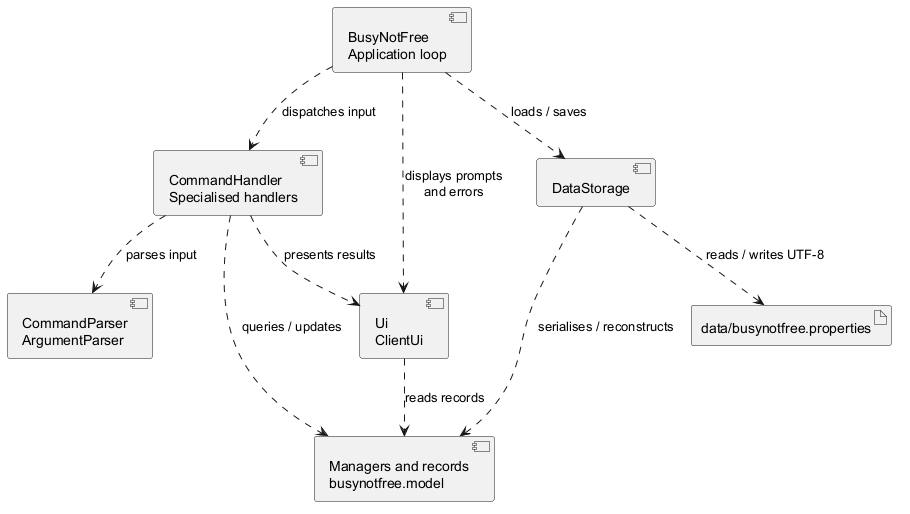
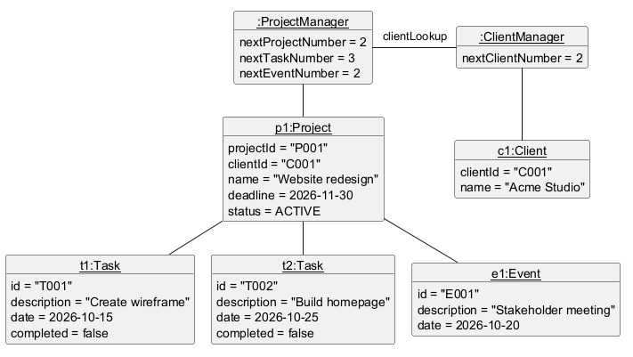
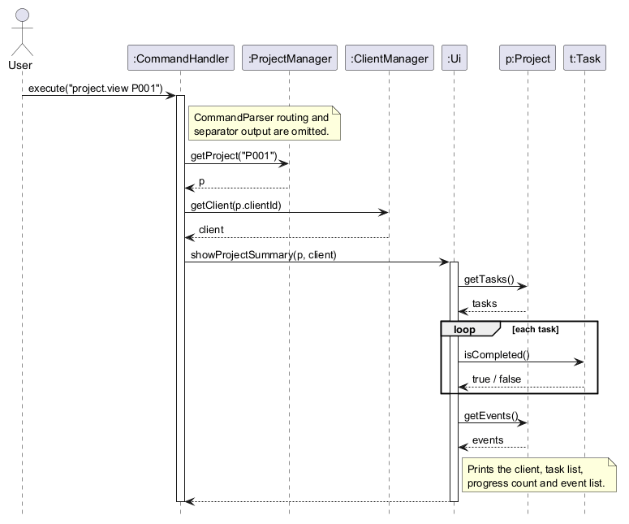
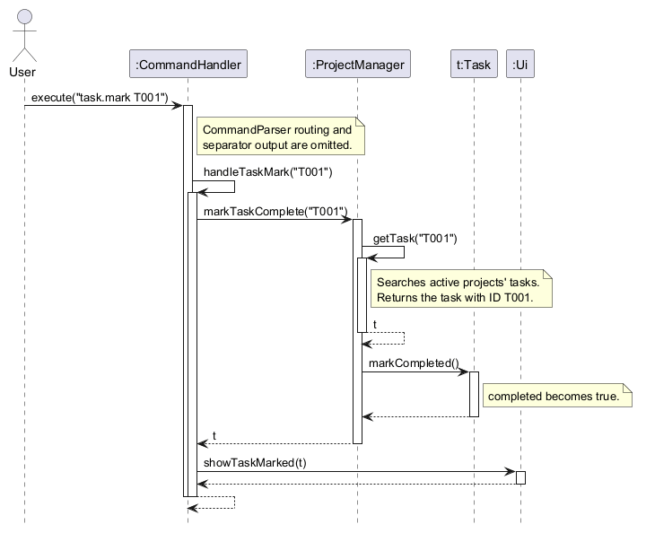

# Developer Guide

## Contents

- [Acknowledgements](#acknowledgements)
- [Architecture overview](#architecture-overview)
- [Shared command processing](#shared-command-processing)
  - [Parsing and routing](#parsing-and-routing)
  - [Validation and error handling](#validation-and-error-handling)
- [Design & implementation](#design--implementation)
  - [Creating projects, tasks and events](#creating-projects-tasks-and-events-projectadd-taskadd-and-eventadd)
  - [Viewing project details](#viewing-project-details-projectview)
  - [Project tracking and status views](#project-tracking-and-status-views-projectlist-projectstatus-projectfilter-projectdeadlines-and-projectoverdue)
  - [Task completion, project progress and persistence](#task-completion-project-progress-and-persistence)
  - [Editing tasks and events](#editing-tasks-and-events-taskedit-and-eventedit)
  - [Managing clients](#managing-clients-clientadd-clientnote-clientview-and-clientlist)
  - [Safe deletion and project recovery](#safe-deletion-and-project-recovery)
  - [Command discovery and internal consistency checks](#command-discovery-and-internal-consistency-checks)
- [Product scope](#product-scope)
- [User stories](#user-stories)
- [Non-functional requirements](#non-functional-requirements)
- [Glossary](#glossary)
- [Instructions for manual testing](#instructions-for-manual-testing)

## Acknowledgements

* Documentation structure follows the [AddressBook-Level3 User Guide](https://se-education.org/addressbook-level3/UserGuide.html), [Developer Guide](https://se-education.org/addressbook-level3/DeveloperGuide.html) and [PPP example](https://se-education.org/addressbook-level3/team/johndoe.html), as recommended by the [CS2113 deliverables guidance](https://nus-cs2113-ay2627-s1.github.io/website/admin/tp-deliverables.html).
* UML notation follows the course's [Modeling (Using UML) chapter](https://nus-cs2113-ay2627-s1.github.io/website/se-book-adapted/chapters/modeling.html).
* Diagrams are authored and rendered with [PlantUML](https://plantuml.com/).

## Architecture overview

BusyNotFree is a single-process Java command-line application. The component diagram
groups the existing classes by responsibility; dashed arrows show which group uses
another. It omits individual model relationships, which are shown in the feature diagrams.



| Responsibility | Main classes | Role |
| --- | --- | --- |
| Application | `BusyNotFree` | Loads saved data, reads terminal input, coordinates saves and decides when the session ends. |
| Commands | `CommandHandler`, `ClientCommandHandler`, `TrashcanCommandHandler` | Route commands, validate command-specific arguments and request model operations. |
| Parsing | `CommandParser`, `ArgumentParser` | Separate command words and arguments, and validate prefixed values and dates. |
| Model | `ClientManager`, `ProjectManager`, `TrashcanManager` and their records | Maintain active/deleted data, relationships, completion states and ID counters. |
| User interface | `Ui`, `ClientUi` | Format prompts, confirmations, results and errors using the supplied model records. |
| Storage | `DataStorage` | Convert managers to and from the UTF-8 properties file, including trashcan records and ID counters. |

At startup, `DataStorage#load` returns client and project managers that share one
trashcan. `BusyNotFree` supplies those managers and one `Ui` to `CommandHandler`,
which creates its specialised handlers. A save callback captures the same managers
for both `save` and `exit`; commands and persistence therefore use the same session data.
The properties file is `data/busynotfree.properties` relative to the working directory.

## Shared command processing

This section describes the flow shared by the feature handlers. The implementation
sections below explain each command's additional validation and model changes.

### Parsing and routing

1. `BusyNotFree#run` reads one line. If a deletion confirmation is pending,
   `CommandHandler` treats the line as a confirmation answer before normal routing.
2. Otherwise, the application handles standalone `save` itself. It sends other input
   to `CommandHandler#execute`, which recognises `exit` and `help` before parsing
   dotted commands such as `project.view`.
3. `CommandParser` separates a dotted command into its target, action and argument
   text, held in a `ParsedCommand`. It checks the command-word structure;
   `CommandHandler#routeCommand` and the specialised handlers check supported actions.
4. Handlers validate positional IDs and use `ArgumentParser` for prefixed fields.
   Each required prefix must occur once with a non-blank value; field order is free.
   A recognised prefix that is not allowed for the command is rejected. Unrecognised
   slash-containing text within a value remains part of that value. Dates must match
   `YYYY-MM-DD` exactly and represent a real calendar date.
5. Managers and domain objects check model relationships and invariants before a
   successful change is committed. The handler passes the result to `Ui` or `ClientUi`.

`CommandHandler#execute` returns a boolean to the application loop: `true` requests
saving and exit, while `false` continues the session. This internal control value
is omitted from the feature sequence diagrams; the human user receives console output.
The [saving section](#saving-during-a-session-or-on-exit) explains the callback and retry behaviour.

### Validation and error handling

| Failure | Handling boundary | Result |
| --- | --- | --- |
| Malformed command, positional arguments, prefixes or dates | A parser or handler throws `CommandException`; `CommandHandler#execute` catches it. | Display the error and a usage hint when one is available, then continue reading input. |
| Missing record or invalid model data | The model throws a subclass of `BusyNotFreeException`; `CommandHandler#execute` catches it. | Display the error and the supported command's usage hint. Rejected input leaves existing data and ID counters unchanged. |
| Client deletion blocked by associated projects | `CommandHandler#execute` catches `ClientHasProjectsException` separately. | Display the relationship error without an additional usage hint. |
| Failed write during `save` or `exit` | `BusyNotFree#saveData` catches `IOException`. | Report the failure and retain the session so an explicit save/exit can be retried. At end of input, report the failure and return. |
| Invalid or unreadable file at startup | `DataStorage#load` reports `IOException`; `BusyNotFree#main` catches it. | Display a load error and stop before accepting commands or overwriting the file. |

If parsing fails before a `ParsedCommand` is available, the shared handler displays
the error without trying to infer a command-specific usage hint. Deletion confirmations
have their own yes/no validation; finish or cancel confirmation before another command.
Assertions check internal assumptions during development. Unexpected programming
exceptions and assertion failures are not swallowed by the command-error handler.

## Design & implementation

The following sections explain the implemented commands, their model relationships,
validation and persistence. Diagrams focus on the classes and interactions relevant
to each enhancement.

### Creating projects, tasks and events: `project.add`, `task.add` and `event.add`

These commands create the core records of BusyNotFree:

* `project.add client/CLIENT_ID name/PROJECT_NAME due/YYYY-MM-DD` creates a project for an existing client.
* `task.add project/PROJECT_ID name/DESCRIPTION date/YYYY-MM-DD` adds a dated internal task to an existing project.
* `event.add project/PROJECT_ID name/DESCRIPTION date/YYYY-MM-DD` adds a dated event, such as a meeting or review, to an existing project.

#### Model

The class diagram below shows the model classes involved.


* `ProjectManager` keeps active projects in insertion order and assigns IDs. A restored project is appended; after a restart, projects are loaded in numeric ID order. It has a separate counter for each ID type: `P001` for projects, `T001` for tasks and `E001` for events. Task and event IDs are unique across the whole application, not just within one project, so later commands such as `task.mark T001` do not need a project ID.
* `Project` owns two separate lists, one of `Task` objects and one of `Event` objects. `getTasks()` and `getEvents()` return unmodifiable copies, so other classes cannot change a project's items without going through `Project`.
* `Task` and `Event` extend the abstract class `ScheduledItem`, which holds the fields they share: ID, owning project, description and date.
* `ProjectManager` checks that a client exists through the `ClientLookup` interface, which `ClientManager` implements.

The object diagram below shows the model after these commands are entered in order:

```text
client.add name/Acme Studio
project.add client/C001 name/Website redesign due/2026-11-30
task.add project/P001 name/Create wireframe date/2026-10-15
task.add project/P999 name/Draft copy date/2026-10-18
task.add project/P001 name/Build homepage date/2026-10-25
event.add project/P001 name/Stakeholder meeting date/2026-10-20
```



* The second `task.add` is rejected because `P999` does not exist. It does not use up an ID, so the next task is `T002` and `nextTaskNumber` is `3`.
* Task and event IDs are counted separately, so `e1` is `E001` even though two tasks were added first.
* `p1` stores only the client's ID, `"C001"`, and has no link to `c1`. The client is looked up through `ClientManager` when it is needed, for example to show its name in a confirmation.

#### Parsing the command

All three commands are parsed the same way before the model is changed:

1. `CommandParser` splits the input into a target (`project`, `task` or `event`), an action (`add`) and the remaining argument text.
2. `CommandHandler#routeCommand` sends the command to `handleProjectAdd`, `handleTaskAdd` or `handleEventAdd`.
3. The handler calls `ArgumentParser#parse` with the prefixes the command requires, for example `"project", "name", "date"` for `task.add`. It returns a map from each prefix to its trimmed value. The prefixes may appear in any order.
4. The handler calls `ArgumentParser#parseDate` to turn the date text into a `LocalDate`.

`ArgumentParser#parse` rejects a missing, blank, repeated or unexpected prefix with a `CommandException`. A prefix is recognised only at the start of the arguments or after a space. Slashes that are not recognised prefixes stay part of the value, so names such as `Create UI/UX mockup` or `Review src/main changes` are accepted as typed.

`ArgumentParser#parseDate` first checks that the text matches `YYYY-MM-DD` exactly, then parses it with `LocalDate#parse`, which rejects dates that do not exist, such as `2026-02-30`.

#### Creating a project

The sequence diagram below shows how `project.add client/C001 name/Website due/2026-11-30` is executed.


`ProjectManager#addProject` builds the `Project` using the next project ID. The `Project` constructor rejects a blank client ID or name and a missing deadline. The manager then asks its `ClientLookup` whether the client exists. Only after both checks pass does it store the project and advance the counter:

```java
public Project addProject(String clientId, String name, LocalDate deadline) {
    Project project = new Project(formatId("P", nextProjectNumber), clientId, name, deadline);
    if (!clientLookup.exists(project.getClientId())) {
        throw new ProjectException("Client " + project.getClientId()
                + " does not exist. Use client.list to see client IDs.");
    }
    projects.put(project.getProjectId(), project);
    nextProjectNumber++;
    return project; // logging omitted from this excerpt
}
```

After the project is created, `CommandHandler` looks up the client in `ClientManager` so that the confirmation can show both names, e.g. `Created project P001 "Website" for client C001 "Acme Studio".`

#### Adding a task or an event

The sequence diagram below shows how `task.add project/P001 name/Wireframe date/2026-10-15` is executed. `event.add` follows the same steps, using `addEvent`, `Event`, `Project#addEvent` and the `E` ID prefix.


1. `ProjectManager#addTask` finds the project with `getProject`, which throws a `ProjectException` if the project does not exist. Missing projects are never created automatically.
2. It creates the `Task` with the next task ID. The `ScheduledItem` constructor rejects a blank description or a missing date.
3. `Project#addTask` checks that the task belongs to this project and that its ID is not already used, then adds it to the task list.
4. Only then does the manager advance the task counter. `CommandHandler` passes the new task to `Ui#showTaskAdded`.

#### Handling errors

Each layer throws its own subclass of the unchecked `BusyNotFreeException`: `CommandException` for malformed input, `ProjectException`, `TaskException` and `EventException` for invalid model data. `CommandHandler#execute` catches `BusyNotFreeException`, displays its message, and then shows the format of the failed command through `Ui#showAddCommandUsage`. The application keeps running, so the user can enter a corrected command. Unrelated programming errors are not caught, so they are not hidden.

#### Design considerations

* **IDs are only used up by successful commands.** Every check runs before a record is stored and its counter is advanced. A rejected command therefore leaves no gap in the ID sequence, and deleted IDs are never reused because the counters are saved by `DataStorage`.
* **`ProjectManager` depends on the `ClientLookup` interface, not on `ClientManager`.** Project creation could therefore be built and tested before client management was ready, using `PlaceholderClientLookup`. Tests can also supply a lambda such as `clientId -> false` to simulate a missing client.
* **A shared `ScheduledItem` superclass for tasks and events.** The common fields and checks live in one place. Each subclass passes its own exception type into the constructor as a function, for example `TaskException::new`, so a failed check throws the right exception without duplicating the checks.
  * Alternative considered: a single `Activity` class with a type field. This was rejected because tasks and events behave differently; for example, only tasks can be marked complete. Separate classes also keep the task and event sections of `project.view` simple.
* **Prefixed arguments in any order.** The trade-off is that recognised prefixes such as `name/` cannot appear after a space inside a value. Alternative considered: quoting or escaping values. This was rejected as harder to type, because descriptions that need a reserved prefix are rare.
* **Strict dates.** Impossible or loosely formatted dates are rejected instead of being corrected, so a typo cannot silently schedule work on the wrong day.
* **Logging without private text.** `ProjectManager` logs creation at the `FINE` level and includes only IDs, never client names or descriptions.

### Viewing project details: `project.view`

`project.view P001` displays one project's client, status, deadline, tasks, progress and events.
The sequence diagram follows a successful lookup. The [shared parsing and routing](#parsing-and-routing)
steps and separator output are omitted.



`CommandHandler#handleProjectView` asks `ProjectManager` for the requested project. It then
resolves the project's client ID through the shared `ClientManager` and passes both objects to
`Ui#showProjectSummary`. The handler asserts that the returned IDs match the requested project
and client IDs; these assertions check internal lookup consistency, while exceptions handle
invalid user input. `Ui` reads the task and event lists and formats them separately. Neither
viewing nor counting changes the model.

With no ID or with `all`, the handler obtains the projects in insertion order from
`ProjectManager#getProjects` and prints each summary with one blank line between them. An empty
collection produces `No projects found.`. An unknown single ID produces a user-facing error
and usage hint without ending the command loop. Diagnostics at `FINE` level record the requested
ID or number of projects, not client names or task descriptions.

### Project tracking and status views: `project.list`, `project.status`, `project.filter`, `project.deadlines` and `project.overdue`

These commands let a freelancer inspect projects, update a project's status and
identify work that needs attention. The listing and query commands are read-only;
`project.status` changes only the selected project's status.

#### Command routing and validation

`CommandParser` separates the `project` target, action and remaining argument
text. `CommandHandler#routeCommand` then delegates the five actions to their
corresponding handlers:

* `project.list` obtains all projects in creation order. Extra arguments
  are ignored, so the command remains convenient to use interactively.
* `project.status PROJECT_ID STATUS` requires exactly one project ID and one
  status. `CommandHandler#parseProjectStatus` accepts `active`, `paused`,
  `completed` and `cancelled` without considering capitalisation.
* `project.filter STATUS` requires exactly one valid status and displays only
  matching projects.
* `project.deadlines` and `project.overdue` reject unexpected arguments. The
  latter displays only active projects whose deadlines are before today's date.

Malformed input, an unknown status or an unknown project ID raises a command or
model exception. `CommandHandler#execute` catches these expected exceptions,
shows the relevant usage format and continues accepting commands.

#### Model and UI responsibilities

`ProjectManager` stores projects in insertion order. Its query methods return
new list snapshots rather than exposing the internal collection:

* `getProjects()` supports the creation-order output of `project.list`.
* `changeProjectStatus()` changes only the status of an existing project.
* `getProjectsByStatus()` filters projects without modifying them.
* `getProjectsByDeadline()` sorts by the earliest deadline while preserving
  creation order for projects with the same deadline.
* `getOverdueActiveProjects()` selects active projects whose deadlines are
  before the supplied date.

`Ui#showProjects` formats the results consistently and displays
`No projects found.` for an empty query result. `project.overdue` uses the
overloaded method to display `No overdue projects found.` instead. This keeps
result formatting in the UI rather than duplicating it in each command handler.

#### Design considerations and verification

The status parser is shared by `project.status` and `project.filter`, so both
commands accept the same values and capitalisation rules. Deadline sorting and
overdue detection are implemented in `ProjectManager`, keeping date comparisons
out of the command-routing layer. Status updates are kept separate from the
read-only queries so listing or filtering cannot accidentally mutate project
data.

`CommandHandlerTest` and `ProjectManagerTest` cover project listing, status
changes, invalid input, status filtering, deadline ordering and overdue active
projects. The manual testing sequence in the Developer Guide also exercises all
five commands together with project creation and viewing.

### Task completion, project progress and persistence

This v2.0 enhancement lets users finish or reopen tasks, see progress in `project.view`, and
retain completion state across restarts. The diagram shows where completion state lives and
which classes read or write it. Methods unrelated to this enhancement are omitted.


The solid arrow from `ProjectManager` to `Project` represents the manager's retained project
references. The filled diamond at `Project` represents its ownership of tasks: each task belongs
to one project. Dashed arrows represent temporary use by `DataStorage` and `Ui`, which receive
these model objects through calls rather than keeping them as fields. The inherited scheduling
fields of `Task` are omitted; see the creation model above for `ScheduledItem`.

#### Marking and reopening tasks

`Task` owns one `completed` boolean, initially `false`. `task.mark TASK_ID` sets it to `true`;
`task.unmark TASK_ID` sets it back to `false`. The task's ID, owning project, description and
date do not change. `Task#toString` adds `[COMPLETED]` or `[In Progress]` so the state is visible
beside each task in a project summary.

The command handler requires exactly one task ID before asking `ProjectManager` to update the
task. Task IDs are unique across the application, so the user need not supply a project ID.
`ProjectManager#getTask` searches the tasks of each project, returns the matching object, or
throws `TaskException` for an unknown ID. A failed lookup leaves every task unchanged. Repeating
`task.mark` or `task.unmark` has the same result as applying it once.

The sequence diagram shows `task.mark T001`. `task.unmark` follows the same path through
`markTaskIncomplete` and `Task#markIncomplete`.



Rejected mark/unmark commands follow the [shared error-handling flow](#validation-and-error-handling).
The error and task-command format are displayed before another command is accepted.

#### Calculating project progress

`Ui#showProjectSummary` obtains the project's task list once. While printing each task, it
counts the ones whose `isCompleted()` value is `true`. It then prints the completed count and
the list size, for example `Progress: 1 of 2 tasks completed.`. The zero-task case prints
`No tasks found.` and `Progress: 0 of 0 tasks completed.`. Events appear in their own section
and are never part of the task count. For `project.view all`, each summary calculates its own
count, so progress from one project cannot affect another.

The count is derived when a summary is displayed instead of being stored in `Project`. This
avoids a second value that could become stale when a task is marked, reopened or deleted.

#### Saving during a session or on exit

`save` lets a user persist current data without ending the session. `BusyNotFree#run` recognises
this standalone command before sending dotted commands to `CommandHandler`. It rejects extra
arguments, calls `saveData`, shows `Data saved.` only if the write succeeds, then prompts for
another command. `BusyNotFree` coordinates saving, while `DataStorage` performs file I/O.
The sequence diagram shows a successful standalone save. Callback invocation and filesystem
calls are summarised in UML notes to keep the scenario focused.


In `BusyNotFree#main`, the `SaveAction` callback is connected to
`DataStorage#save(clientManager, projectManager)`. Both `save` and `exit` use `saveData`, which
returns `true` only when that action completes normally. On `IOException`, it displays
`Critical ERROR!!! Unable to save data: ` followed by the cause and returns `false`.
`SaveAction` lets tests simulate a failed write without accessing the real filesystem.

| Trigger | Successful write | Failed write |
| --- | --- | --- |
| `save` without arguments | Show `Data saved.` and continue reading commands. | Show the error and continue reading commands. |
| `exit`, including extra words | `CommandHandler#execute` returns `true`; `saveAndReportExit` saves, shows `Data saved. Goodbye!` and ends the loop. | Show the error and continue reading commands so the user can retry. |
| End of input | Cancel any pending deletion, save, show the goodbye message and return. | Show the error and return because no further input is available. |

`save` with arguments is rejected before the callback is called. While a deletion confirmation
is pending, `save` and `exit` are treated as confirmation answers rather than commands.

#### Writing and restoring task completion

`DataStorage#save` gathers tasks from every project, sorts them by their application-wide IDs,
and writes each flag alongside the task's existing fields in the version 1 properties file.
For example, `task.0.completed=true` records a completed task. It writes a temporary UTF-8
file in the data directory before replacing the old file. An atomic replacement is attempted
first, with an ordinary replacement when the filesystem does not support atomic moves. This
reduces the risk of a partially written data file; the fallback does not provide the same
atomicity guarantee. The save also includes client notes, next-ID counters and the team's
trashcan data.

On the next launch, `DataStorage#load` creates linked client and project managers, restores
clients and projects first, then reconstructs tasks and events. `loadTasks` advances the task
counter to each saved ID before calling `ProjectManager#addTask`, so gaps from deleted IDs are
preserved. Once each task exists, a saved `true` flag marks it complete. A missing flag defaults
to `false`, so data files produced before this enhancement still load with their tasks in
progress. Only the exact values `true` and
`false` are accepted; an invalid value makes loading fail instead of silently changing a task's
state. Finally, the saved next-ID counters prevent deleted IDs from being reused after a restart.

The following diagram focuses on restoring one task inside `DataStorage#loadTasks`, after
clients and projects have been loaded. The task is a new object in the new application run;
its constructor call starts its lifeline. File reading, project registration and counter
bookkeeping are omitted where noted.


Marking and reopening change only the in-memory model. The next successful `save` or `exit`
writes the new state. `BusyNotFree#main` reports a load error and stops if a saved file is
invalid, before creating the command loop or saving anything over the file. A missing file
creates empty, linked managers. The path `data/busynotfree.properties` is resolved relative
to the process working directory, not the JAR's directory.

#### Diagram notation and maintenance

These diagrams use the notation in the course's [Modeling (Using UML) chapter](https://nus-cs2113-ay2627-s1.github.io/website/se-book-adapted/chapters/modeling.html#sequence-diagrams-basic).
Solid filled-arrow messages represent synchronous Java calls; dashed arrows represent returns.
Nested activation bars show self-invocation, and an `opt` frame marks the conditional call to
`Task#markCompleted`. Assigning the boolean is described in a note rather than drawn as a
method call. Each sequence diagram describes one scenario in one application run.

Editable sources are in `docs/diagrams`. After changing a source, regenerate its matching PNG
in `docs/images` and inspect it at the guide's reading width. Keep the sources and exported
images together when preparing a PR. The existing `project.view` diagram is unchanged.

#### Design and verification

* A boolean is sufficient because a task has only two completion states. An enum would be more
  useful if additional workflow states were introduced later.
* One properties file keeps task state with its project and client data. Adding an optional
  field avoids changing the file version or rejecting existing v1.0 saves.
* The application handles `save` because it is a standalone command that needs storage access.
  This avoids giving the general `CommandHandler` responsibility for file I/O.
* [`CommandHandlerTest`](https://github.com/AY2627S1-CS2113-T10-3/tp/blob/master/src/test/java/busynotfree/command/CommandHandlerTest.java)
  covers marking, reopening and invalid IDs. [`ProjectViewTest`](https://github.com/AY2627S1-CS2113-T10-3/tp/blob/master/src/test/java/busynotfree/command/ProjectViewTest.java)
  checks empty, partial and complete counts, including `project.view all`.
  [`DataStorageTest`](https://github.com/AY2627S1-CS2113-T10-3/tp/blob/master/src/test/java/busynotfree/storage/DataStorageTest.java) checks
  saved and restored flags, the older-file default and malformed saved data.
  [`BusyNotFreeTest`](https://github.com/AY2627S1-CS2113-T10-3/tp/blob/master/src/test/java/busynotfree/BusyNotFreeTest.java) checks `save` success,
  failure and continued input. [`BusyNotFreeClientTest`](https://github.com/AY2627S1-CS2113-T10-3/tp/blob/master/src/test/java/busynotfree/BusyNotFreeClientTest.java)
  checks that an in-session save can be loaded before a later exit.

### Editing tasks and events: `task.edit` and `event.edit`

`task.edit TASK_ID name/DESCRIPTION date/YYYY-MM-DD` and `event.edit EVENT_ID name/DESCRIPTION date/YYYY-MM-DD` replace the description and date of an existing task or event. Both commands share one implementation path:

1. `CommandHandler#routeCommand` sends `task.edit` to `handleTaskEdit` and `event.edit` to `handleEventEdit`.
2. Both handlers call `parseEditArguments`. It takes the first word as the item ID, then uses `ArgumentParser` to read the required `name/` and `date/` arguments, and `ArgumentParser#parseDate` to check the date. The result is held in a private `EditArguments` record.
3. The handler calls `ProjectManager#editTask` or `ProjectManager#editEvent`. The manager finds the item by its application-wide ID with `getTask` or `getEvent`, searching every project.
4. The manager calls the package-private `Task#edit` or `Event#edit`. Both delegate to `ScheduledItem#updateDetails`, passing in their own exception type.
5. `updateDetails` checks the new description and date with the same `validateDetails` helper used by the constructor, and only then assigns both fields.
6. `Ui#showTaskEdited` or `Ui#showEventEdited` displays the updated item using its `toString()`, so a task also shows its completion state.

```java
protected final void updateDetails(String description, LocalDate date,
        Function<String, ? extends BusyNotFreeException> exceptionFactory) {
    validateDetails(description, date, exceptionFactory);
    this.description = description.trim();
    this.date = date;
}
```

**Design considerations**

* **An invalid edit leaves the item unchanged.** Every check happens before any field is assigned: the command format and date are checked in `CommandHandler`, the ID in `ProjectManager`, and blank values in `ScheduledItem`. Description and date are assigned together, so an edit never applies half of its changes.
* **ID and project cannot change.** `ScheduledItem` keeps `id` and `project` as `final` fields and makes only `description` and `date` editable. `parseEditArguments` accepts only `name/` and `date/`, so `project/` is rejected as an unexpected prefix. Editing does not create an item, so ID counters are not advanced.
* **Completion status is preserved.** `Task#edit` changes only the fields inherited from `ScheduledItem`; it never touches `completed`.
* **Edits go through `ProjectManager`.** `edit` is package-private, like `Project#removeAllActivities`, so other packages cannot change an item without the manager's ID lookup.
* **Alternative considered: replacing the item.** A new `Task` or `Event` could replace the old one in its project's list. This would need extra code to copy the completion state and keep the item's position in the list, so editing the existing object was chosen as the simpler option.
* **Storage needs no change.** `DataStorage` already saves each item's current description and date, so edited values survive a restart.


### Managing clients: `client.add`, `client.note`, `client.view` and `client.list`

Client management lets freelancers register clients and keep notes about their preferences or requirements. The four commands are:

* `client.add name/CLIENT_NAME` registers a client and displays the assigned ID.
* `client.note CLIENT_ID text/NOTE` appends a note to an existing client.
* `client.view CLIENT_ID` displays a client's ID, name and all recorded notes.
* `client.list` displays every client's ID and name in insertion order. Restored clients are appended; after a restart, clients load in numeric ID order.

For example, `client.add name/Acme Studio` can create `C001`, after which `client.note C001 text/Prefers weekly updates` records a preference for that client. IDs are case-sensitive; two clients may have the same name but receive different IDs.

#### Responsibilities and integration

* `CommandHandler` parses the command through `CommandParser` and delegates client addition, viewing, listing, search, editing and note addition to `ClientCommandHandler`. Client and note deletion remain in `CommandHandler` because they use its pending-confirmation state. It also handles errors through the shared `Ui`.
* `ClientCommandHandler` selects the client operation, validates its argument structure and calls `ClientManager`. It reuses `ArgumentParser` for the `name/` and `text/` arguments.
* `ClientManager` owns a `LinkedHashMap<String, Client>` and the next client number. It creates clients, looks them up by ID and directs notes to their owner. The map preserves creation order while supporting ID lookup without scanning every client.
* `Client` holds an immutable ID and name, and an append-only list of notes. Its constructor and `addNote` method reject null or blank values and trim surrounding whitespace.
* `ClientUi` formats client responses and sends them through the shared `Ui#showMessage`, keeping output formatting separate from command parsing and model changes.

`ClientManager` implements `ClientLookup`, allowing `ProjectManager` to check whether a client exists without depending on client command handling. The application uses the same client manager for command handling and project lookup, so a newly registered client can immediately be used by `project.add`. Callers that need this integration should use the four-argument `CommandHandler` constructor with the shared manager; the three-argument constructor creates an independent client manager.

#### Registering a client

The sequence diagram below shows the successful execution of `client.add name/Acme Studio`, assuming the next available client ID is `C001`. It starts after `CommandParser` has parsed the input; separator output and read-only getter calls used for formatting are omitted.


1. `CommandHandler#routeCommand` delegates the parsed command to `ClientCommandHandler#execute`, which selects `handleAdd`.
2. `ArgumentParser#parse(arguments, "name")` requires exactly one non-blank `name/` value. Parsing finishes before the manager is called, so a malformed command cannot allocate an ID.
3. `ClientManager#addClient` formats the next number as an ID with the `C` prefix and at least three digits, then constructs a `Client` with that ID and the supplied name.
4. Only after construction succeeds does the manager put the client in its map and increment `nextClientNumber`. A rejected name therefore leaves both the collection and counter unchanged.
5. `ClientUi#showClientAdded` displays the assigned ID and name, for example `Added client C001: Acme Studio.`.

The three-digit padding is a minimum width, so the sequence continues from `C999` to `C1000`. Client names are not map keys, allowing separate clients with identical names.

#### Recording a client note

The sequence diagram below shows `client.note C001 text/Prefers weekly updates`, assuming `C001` already exists. As above, command parsing, separators and formatting getters are omitted.


1. `ClientCommandHandler#handleNote` separates the first word, the positional client ID, from the remaining prefixed arguments. A missing ID, or a prefix supplied in its place, is rejected.
2. `ArgumentParser#parse(noteArguments, "text")` checks that a non-blank note is supplied exactly once.
3. `ClientManager#addNote` calls `getClient` before attempting the update. A missing client raises `ClientException`; it never creates a client automatically.
4. `Client#addNote` validates and trims the text, then appends it to the existing notes. Earlier notes and other clients are unchanged.
5. `ClientUi#showNoteAdded` confirms the update with `Note added to client C001.`.

Names and notes preserve internal spaces and ordinary slash-containing text such as `UI/UX` or URLs. Recognised argument prefixes at whitespace boundaries remain reserved: for example, `name/` inside a note is treated as an unexpected argument, and a second `text/` is rejected as a repeated prefix. Quoting or escaping reserved prefixes is not supported.

#### Viewing and listing clients

`client.view` requires exactly one positional ID. The handler calls `ClientManager#getClient`, then `ClientUi#showClient` prints the ID and name followed by each note in insertion order as `Note 1: ...`, `Note 2: ...` and so on. These one-based positions are used by `client.delete_note`. A client without notes displays `Notes: No notes found.`. Leading and trailing whitespace around an ID is trimmed, but its case and digits must match an existing ID.

`client.list` calls `ClientManager#getClients`, which returns `List.copyOf(clients.values())`. `ClientUi#showClients` prints numbered entries in insertion order, or `No clients found.` when the collection is empty. Listing omits notes; users can request them through `client.view`. Extra arguments to `client.list` are ignored, matching the application's convention for commands without parameters.

Both `getClients()` and `Client#getNotes()` return unmodifiable snapshots of their collections. Callers cannot add or remove entries through these lists. The client snapshot still contains references to the existing `Client` objects; it is not a deep copy of their state.

#### Validation and error handling

Malformed command arguments raise `CommandException`; invalid client data or an unsuccessful client lookup raises `ClientException`. Both extend `BusyNotFreeException`, which `CommandHandler#execute` catches. It displays the error and, for a supported client action, asks `ClientCommandHandler#showCommandUsage` to display the expected format. The command loop remains available for corrected input. An unsupported client action produces an error without a usage hint.

Assertions check internal assumptions: only client commands reach `ClientCommandHandler`, the next client number is positive, a generated ID cannot replace an existing client, and a successful lookup returns the requested ID. These checks help detect programming errors when assertions are enabled; exceptions still validate user input when assertions are disabled.

#### Design considerations

* **Separate client command handling.** `ClientCommandHandler` and `ClientUi` keep client-specific parsing and formatting together while reusing the shared router, parser and output interface. An alternative would be to place every client action in `CommandHandler`; the separate handler limits the growth of that shared class.
* **IDs identify clients instead of names.** Sequential IDs provide a stable reference for notes and projects even when names are duplicated. Using names as keys would require rejecting duplicates or introducing rules to distinguish them.
* **A map preserves both lookup and display order.** `LinkedHashMap` supports lookup by ID and predictable listing. An `ArrayList` would preserve creation order but require a search for each ID; an ordinary `HashMap` would not guarantee creation order.
* **Notes belong to their client.** An ordered list of strings supports appending, displaying and deleting notes by their displayed positions. Separate note objects with stable IDs would be useful if notes later support independent editing, reordering or concurrent changes.
* **Validate before changing state.** Parsing precedes manager calls, client construction precedes registration and counter advancement, and note validation precedes insertion. Invalid operations therefore leave existing client data unchanged.
* **Persistence is handled separately.** Client commands update the in-memory model. The application's `DataStorage` integration saves clients, notes and the next client number with the project data on `save` or `exit` and restores them at startup. The client handler does not perform file I/O or save after each command.

#### Existing verification

[`ClientTest`](../src/test/java/busynotfree/model/ClientTest.java) and [`ClientManagerTest`](../src/test/java/busynotfree/model/ClientManagerTest.java) cover validation, duplicate names, ID allocation beyond `C999`, note ownership, collection snapshots and real client lookup during project creation. [`ClientCommandHandlerTest`](../src/test/java/busynotfree/command/ClientCommandHandlerTest.java) covers all four commands through the shared router, including malformed input, missing clients, output order and recovery after errors. [`ClientArgumentParserTest`](../src/test/java/busynotfree/command/ClientArgumentParserTest.java) covers free text and reserved prefixes. The repeatable console acceptance scenario is documented in the [UI test plan](../test/ui-test-plan.md).

### Safe deletion and project recovery

This enhancement lets users remove unwanted records while protecting against accidental
deletion and broken relationships. It covers `project.delete`, `client.delete`,
`client.delete_note`, `task.delete`, `event.delete`, `trashcan.list`, `trashcan.restore`
and `trashcan.empty`.

Deletion has two stages: selecting and validating a record, then waiting for confirmation.
Deleted projects and clients are retained as independent snapshots. Individually deleted
tasks, events and notes are removed without entering the trashcan.

#### Trashcan responsibilities and shared wiring

`CommandHandler` coordinates deletion confirmation because subsequent input must answer
the pending operation before normal command processing resumes. It stores the selected
project, client, task or event. For a note, the private `PendingNoteDeletion` record stores
the client ID, one-based index and preview text. The boolean `pendingTrashcanEmpty`
tracks confirmation for clearing the entire trashcan, which has no individual target ID.

`ClientManager` manages active clients and their notes. `ProjectManager` manages active
projects and their tasks and events. Both managers send deleted records to the same
`TrashcanManager`, which owns the deleted snapshots.

`TrashcanCommandHandler` validates and executes listing and restoration commands and supplies
usage hints for all trashcan commands. `CommandHandler` routes `trashcan.empty` before
general trashcan delegation so it can reuse the application's confirmation lifecycle.
The main handler also catches application exceptions and shows errors.
`Ui` and `ClientUi` format the responses.

At startup, `DataStorage#load` creates one `TrashcanManager` and supplies it to both
active-data managers. The command handler obtains that same instance through
`ProjectManager`. Explicit constructor injection makes this shared dependency visible
and allows tests to create an isolated application model. The convenience constructor
`ProjectManager(ClientLookup)` also reuses the trashcan when its lookup is a `ClientManager`.

The class diagram shows the dependencies involved in storing and recovering deleted data.
Active collections, UI classes and unrelated operations are omitted to keep its scope small.
The snapshot associations refer to copies, rather than the original active objects.


#### Confirmation lifecycle

A valid deletion command locates the selected record and displays its identifying details.
At this point, neither the active model nor the trashcan changes.

While confirmation is pending:

* `yes` clears the pending selection and attempts deletion.
* `no` cancels the operation without changing model data.
* Other input displays an error and repeats the confirmation prompt.
* Commands such as `help`, `save` and `exit` are treated as confirmation answers.
* End of input cancels the operation before the application attempts to save.

`BusyNotFree#run` checks `isAwaitingDeletionConfirmation()` before displaying the normal
prompt or handling `save`. `CommandHandler#execute` makes the same check before parsing
commands. Together, these checks prevent another CLI command from replacing the selected
record while confirmation is pending.

The lifecycle uses nullable pending fields for individual records and a boolean for
trashcan emptying. The sequence diagram below
shows how the application handles confirmation answers and end of input. Input reading
is simplified; validation and model deletion details are shown in the project deletion
section. The single-threaded command loop allows only one pending deletion at a time.


#### Project deletion

For `project.delete P001`, `handleProjectDelete` requires exactly one ID, looks up the
project and requests confirmation. After `yes`, `ProjectManager#deleteProject` first
calls `TrashcanManager#storeProject`.

`storeProject` checks for conflicting retained project or activity IDs, then copies the
project. `Project#copy` constructs a new project and new task and event objects. It
preserves identifiers, descriptions, dates, project status and task completion flags.
Each copied activity refers to the copied project.

Only after snapshot storage succeeds does deletion clear the original project's
activities and remove it from the active map. This ordering avoids removing active data
before a recoverable snapshot exists. The original object is cleared, so callers holding
an old reference cannot continue accessing its former activities through that object.
Existing references to individual tasks or events do not point into the retained copy.

The sequence diagram shows a successful request followed by confirmation. Parsing,
lookup self-calls and decorative separators are omitted. If snapshot validation fails,
the manager does not reach the active-data removal steps.


#### Client, note, task and event deletion

| Command | Validation and resulting model change |
| --- | --- |
| `client.delete CLIENT_ID` | Rejects clients with any active project, regardless of project status. Stores a client snapshot with its notes, clears the original notes and removes the active client. |
| `client.delete_note CLIENT_ID index/NOTE_INDEX` | Validates the client and a positive, in-range integer index. Removes exactly that note after confirmation. |
| `task.delete TASK_ID` | Finds the task across active projects and removes it from its owning project. Other tasks and events remain unchanged. |
| `event.delete EVENT_ID` | Finds the event across active projects and removes it from its owning project. Other events and tasks remain unchanged. |

Client deletion rechecks project relationships when confirmation is accepted. A
`ClientHasProjectsException` reports this business-rule failure without a usage hint,
because the command's syntax may already be correct. Missing or invalid IDs continue
to receive usage hints. Failed lookups do not create placeholder records.

Note deletion reuses `ArgumentParser` for `index/`. `parseNoteIndex` rejects nonnumeric
values, nonpositive values and integer overflow. `Client#getNote` checks the index
against the current list size. The model converts the displayed one-based index to a
zero-based list position. `ClientUi` prints notes as `Note 1: ...`, and remaining notes
are renumbered automatically after deletion. Duplicate note text is allowed because the
index selects a position, not the first matching string.

Task and event IDs are unique across the application, so their deletion commands do
not require a project ID. Package-private `Project#removeTask` and `Project#removeEvent`
check ownership before changing the corresponding collection. Deleting a completed task
is allowed; the next project view derives its progress from the remaining task list.

Deletion does not decrease ID counters. This prevents a later record from receiving
the identifier of a deleted record.

#### Listing and restoring deleted projects and clients

`trashcan.list` obtains deleted projects and clients from `TrashcanManager`. The returned
lists contain independent copies, sorted by numeric ID. This protects retained snapshots
from changes made by callers. `Ui#showTrashcan` displays project details, tasks and events,
followed by deleted clients and their notes. If both collections are empty, it displays
`Trashcan is empty.`

`trashcan.restore PROJECT_ID/CLIENT_ID` requires exactly one ID; the slash denotes
alternatives, not literal input. `TrashcanCommandHandler#handleRestore` rejects missing
or multiple IDs before checking the case-sensitive `P[0-9]{3,}` or `C[0-9]{3,}` format.
Malformed IDs produce a `CommandException`; well-formed IDs absent from the trashcan
produce the corresponding `ProjectException` or `ClientException`. The shared handler
displays the error and updated usage hint without changing model data.

For a project ID, `TrashcanManager#restoreProject`
finds the retained snapshot and calls `ProjectManager#registerRestoredProject`.

Registration verifies that the original client is active and that the project, task and
event IDs do not conflict with active data. It then adds the project to the active
collection. Only after registration succeeds does the trashcan remove its entry. A
failed registration therefore leaves the project available for a later restoration attempt.

The restored project retains its original activities and their ownership references.
Restoration appends the project to the active collection without allocating new IDs or
advancing counters. A second restore request for the same ID fails because the entry is
no longer in the trashcan.

The sequence diagram focuses on registration. Command argument validation and the initial
trash lookup must already have succeeded. Validation failures are summarized as one branch.


For a client ID, `TrashcanManager#restoreClient` finds the retained client, then calls
`ClientManager#registerRestoredClient`. Registration rejects an ID that is already
active before inserting the snapshot into the active map. Only after successful
registration does the trashcan remove its entry. The original client ID, name, note
order and duplicate note text are preserved; ID counters do not change. Active clients
with the same name but different IDs do not prevent restoration.


Restoring a client does not automatically restore its projects. If both were deleted,
restore the client first, then each project. This preserves the existing project
validation and avoids partially restoring a group when one project has an ID conflict.
Repeating either restore command fails because its snapshot has already been removed.

#### Permanently emptying the trashcan

`trashcan.empty` accepts no arguments. `CommandHandler#routeCommand` rejects extra
arguments with a `CommandException` before setting any pending state. The shared error
handler then displays `Use trashcan.empty without arguments.` and the usage hint
`Format: trashcan.empty`, supplied by `TrashcanCommandHandler#showCommandUsage`.

For a valid request, the handler sets `pendingTrashcanEmpty` and asks
`Permanently delete all items in the trashcan? Type yes or no.`. No model data changes
at this point. `isAwaitingDeletionConfirmation()` includes this flag, so the existing
command loop prevents other commands, including `save` and `exit`, from bypassing
confirmation.

`handleDeletionConfirmation` routes the answer to `handleTrashcanEmptyConfirmation`:

* `yes` calls `TrashcanManager#empty`, resets the flag and displays `Trashcan emptied.`.
* `no` calls `cancelPendingDeletion`, resets the flag and displays
  `Trashcan emptying cancelled.` without changing retained entries.
* Other answers display an error and repeat the prompt, leaving the flag and entries unchanged.
* End of input invokes `cancelPendingDeletion` before the command loop attempts to save.

The sequence diagram shows a valid request followed by confirmation. The application
input loop, parsing, separators and invalid-answer retries are omitted; those follow
the shared confirmation lifecycle.


`TrashcanManager#empty` clears both `deletedProjects` and `deletedClients`. Retained
project activities and client notes disappear with their owning snapshots. Active managers,
their records and their ID counters are unchanged. Clearing an already empty trashcan
succeeds after the same confirmation. Emptied entries cannot subsequently be restored.

#### Persistence and compatibility

`DataStorage` saves trashcan records in the existing properties file under keys beginning
with `trash.`. The same serialization helpers handle active and deleted records, including
client notes and task completion flags. For example, `trash.project.count` records the
number of retained projects, while `trash.task.0.completed` records a retained task's state.

Loading reconstructs active records first. Optional trash data is then reconstructed
using temporary managers and imported through the active managers' storage methods.
Import validates conflicting IDs and reserves the identifiers held by deleted records
before the saved next-ID counters are applied.

Deleted projects may refer to deleted clients while retained in the trashcan. Loading
accepts this relationship, but restoration still requires the client to be active.

Older files without a trash section load with an empty trashcan. Active clients and
projects are written in numeric ID order because restoring older records can append
them after newer records in memory, while the loader reconstructs IDs in ascending
order. `DataStorage#save` sorts snapshots for serialization without changing the
in-memory insertion order.

Deletion, restoration and trashcan emptying change in-memory data. The existing `save` and `exit` paths
persist those changes using the temporary-file replacement described in the persistence
section. No command-specific file writes are introduced.

After emptying, the next save writes zero trashcan counts and omits the former entry keys
because `DataStorage#save` builds a fresh `Properties` object. Loading that file therefore
does not resurrect old entries. Saved next-ID counters still prevent reuse of deleted IDs;
the storage format needs no changes.

#### Design choices and alternatives

* **Snapshots rather than original references:** copying prevents changes through old
  references from altering recoverable data. The cost is additional memory while records
  remain in the trashcan.
* **Restore original IDs rather than create replacements:** this preserves project
  ownership and activity identifiers. It requires conflict checks before registration.
* **Separate trashcan responsibilities:** `TrashcanManager` owns retained data;
  `TrashcanCommandHandler` handles listing, project/client restoration and usage hints. `CommandHandler`
  coordinates emptying because it owns confirmation state. Active-data managers retain
  their validation rules and ID counters.
* **Explicit confirmation rather than immediate deletion:** the extra interaction gives
  users an opportunity to inspect the selected record before changing data. Emptying also
  requires confirmation because all retained entries become unavailable for restoration.
  Immediate clearing would need less command state but would provide no cancellation step.
* **Indexed string notes rather than note entities:** this is sufficient for the current
  feature. Stable note IDs would be more suitable if notes later support independent
  editing, reordering or concurrent changes.

A shared confirmation abstraction could reduce the repeated handlers, but the current
implementation keeps each deletion path explicit. It would become more useful if more
commands needed the same confirmation behavior.

#### Verification and current limitations

[`TrashcanCommandTest`](../src/test/java/busynotfree/command/TrashcanCommandTest.java) covers
listing, invalid restoration requests, successful restoration, inactive clients, repeated
restoration and conflicting IDs. Client restoration tests cover missing/malformed IDs,
absent or active clients, repeated restoration, note counts and restoring a client
before its project. It also covers confirmed emptying, rejected arguments,
repeated emptying, cancellation, invalid confirmation answers and preservation of active
records and ID counters.
[`TrashcanManagerTest`](../src/test/java/busynotfree/model/TrashcanManagerTest.java) checks
shared wiring, snapshot isolation, duplicate retained IDs and failed registration preserving
the snapshot. Client restoration checks also cover note preservation, unchanged counters
and rejection of conflicting active IDs without losing the retained client.
[`TrashcanCommandHandlerTest`](../src/test/java/busynotfree/command/TrashcanCommandHandlerTest.java)
verifies delegated parsing and response behavior.

Deletion tests in [`CommandHandlerTest`](../src/test/java/busynotfree/command/CommandHandlerTest.java)
and [`ClientCommandHandlerTest`](../src/test/java/busynotfree/command/ClientCommandHandlerTest.java)
cover invalid IDs, invalid note indexes, confirmation, cancellation and preservation of
unrelated records. [`BusyNotFreeTest`](../src/test/java/busynotfree/BusyNotFreeTest.java) checks
cancellation before saving at end of input, including pending trashcan emptying, and
checks that `save` cannot bypass emptying confirmation.
[`DataStorageTest`](../src/test/java/busynotfree/storage/DataStorageTest.java) covers persistence,
older files, restoration of older projects and prevention of ID reuse. Its emptying test
first loads previously saved trash, clears it, saves again and reloads to verify both
collections stay empty while next-ID counters are preserved. Its client restoration
test restores an older client after a newer active client, saves and reloads, checks
note order and counters, and restores the retained project with its activities.

The trashcan has no automatic expiry; users can explicitly clear it with `trashcan.empty`.
Project restoration requires an active client; a retained client can now be restored
first. Individually
deleted activities and notes cannot be recovered. These are current limitations, rather
than behavior provided by this enhancement.

### Command discovery and internal consistency checks

The standalone `help` command is recognized by `CommandHandler#execute` before dotted-command
parsing and delegates to `Ui#showHelp`. The UI lists command names and short descriptions
without changing application data. While deletion confirmation is pending, `help` is handled
as a confirmation answer, preserving the selected operation.

Assertions document internal assumptions, including consistent activity-removal counts and
the absence of a deleted project from the active map. They help expose implementation errors
during development. User-input validation continues to use exceptions because assertions may
be disabled at runtime; disabling assertions must not make invalid user input acceptable.

For example, `ProjectManager#deleteProject` asserts that the removed activity count matches
the original count and that the project is no longer registered. These checks complement
JUnit tests; they do not replace invalid-ID or relationship checks. Run the application with
assertions enabled during development (`java -ea -jar build/libs/BusyNotFree.jar`).

#### Maintaining the diagrams

The six deletion and recovery diagrams use editable PlantUML sources in `docs/diagrams`.
Export matching PNG files to `docs/images` after source changes and check that their labels
remain readable alongside the guide text. Sequence diagrams omit repetitive getters and
formatting calls. Their notes identify the simplified scope. Deletion and recovery use
one class diagram and five sequence diagrams, including client restoration and emptying.

Notation follows the course's [Modeling (Using UML) chapter](https://nus-cs2113-ay2627-s1.github.io/website/se-book-adapted/chapters/modeling.html#class-diagrams-basics).
Solid association lines show retained references, dashed dependencies show temporary
use of active-data managers during restoration and the trashcan during emptying,
and filled diamonds mark project-owned
activities. Sequence participants use instance labels such as `:CommandHandler`;
solid filled-arrow messages represent synchronous calls and dashed messages represent
returns. `loop` and `alt` frames describe repetition and mutually exclusive paths.
Optional activation bars and returns are omitted where they add no relevant information.
Removing a record from a collection is not shown with an object-destruction cross because
other Java references can still exist; snapshots are separate objects.

## Product scope
### Target user profile

BusyNotFree is intended for freelancers and consultants who manage several
clients and need a lightweight way to track projects, deadlines, tasks, events,
and client notes from a command line.

### Value proposition

The application provides a fast, keyboard-driven workflow for keeping client
work organised without requiring a separate project-management service.
Projects group dated tasks and events, while stable IDs make related records
easy to reference from later commands.

## User Stories

|Version| As a ... | I want to ... | So that I can ...|
|--------|----------|---------------|------------------|
|v1.0|new user|see usage instructions|refer to them when I forget how to use the application|
|v1.0|freelancer|register clients and keep notes about them|retain client details alongside their projects|
|v1.0|freelancer|create a project for an existing client with a deadline|organise and plan the client's work|
|v1.0|freelancer|add a dated internal task to a project|track the work that needs to be completed|
|v1.0|freelancer|add a scheduled event to a project|keep track of meetings, reviews and presentations|
|v1.0|freelancer|view one or all project summaries|check clients, deadlines, tasks and events together|
|v1.0|freelancer|save my work when I exit|continue from the same data on the next run|
|v2.0|freelancer|mark a task complete or reopen it|keep its status aligned with the work left to do|
|v2.0|freelancer|see a completed-task count for each project|assess progress at a glance|
|v2.0|freelancer|retain task completion after restarting|avoid marking the same tasks again|
|v2.0|freelancer|save my work without exiting|protect recent changes during a long session|
|v2.0|freelancer|find clients by part of their name|locate a client without reading the entire client list|
|v2.0|freelancer|edit a client's name while keeping their ID and notes|update client details without breaking project links|
|v2.0|freelancer|change project statuses and filter projects by status|focus on work in the relevant stage|
|v2.0|freelancer|list projects by deadline and identify overdue active projects|prioritise time-sensitive work|
|v2.0|freelancer|confirm or cancel deletion of unwanted records|remove data deliberately while preserving unrelated work|
|v2.0|freelancer|restore a deleted client and their deleted projects with the original details|recover from accidental deletion|
|v2.0|freelancer|permanently empty the trashcan after confirmation|remove retained records I no longer need|
|v2.0|freelancer responding to changes in client requirements|edit an existing task's description and date without changing its ID or project|keep the work plan accurate|
|v2.0|freelance consultant arranging client meetings|edit an existing event's description and date without changing its ID or project|update a rescheduled meeting without deleting and recreating it|

## Non-Functional Requirements

* The application runs with Java 25 and can be launched from IntelliJ IDEA or a
  standard terminal.
* User input is validated before model mutation. Invalid input must not consume
  a new ID or change existing records.
* Saved data is loaded from and written to the documented properties file.
* User-facing output is plain text and remains readable in ordinary terminal
  windows.
* Automated tests cover command parsing, routing, model behaviour, persistence,
  and the application loop.

## Glossary

* *Client* - A person or organisation whose work is being managed.
* *Project* - A body of work belonging to one client.
* *Task* - A dated piece of internal work attached to a project. It can be marked complete
  or reopened, and it contributes to the project's completed-task count.
* *Event* - A dated meeting, review or appointment attached to a project. It has no task
  completion flag and is excluded from the project's progress count.
* *Trashcan* - Persistent storage for deleted projects and clients that may be
  restored where supported.
* *Prefix* - The name before `/` in an argument, such as `name/` or `date/`.

## Instructions for manual testing

Use Java 25 from the repository root. Run the application with
`.\gradlew.bat run` or run `busynotfree.BusyNotFree.main()` from IntelliJ IDEA.
The following sequence exercises command discovery, client management, project
creation and views, task and event updates, project filtering, saving, and
deletion recovery. Use the IDs printed by the application if data already
exists:

```text
help
client.add name/Acme Studio
client.note C001 text/Prefers weekly updates
client.view C001
client.list
client.find Acme
client.edit C001 name/Acme Consulting
project.add client/C001 name/Website redesign due/2026-11-30
task.add project/P001 name/Create wireframe date/2026-10-15
event.add project/P001 name/Stakeholder meeting date/2026-10-20
task.mark T001
task.edit T001 name/Revised wireframe date/2026-10-18
event.edit E001 name/Rescheduled meeting date/2026-10-22
project.list
project.filter active
project.deadlines
project.overdue
project.view P001
save
task.unmark T001
project.status P001 completed
project.delete P001
yes
trashcan.list
trashcan.restore P001
trashcan.list
exit
```

For deletion commands, enter `yes` or `no` when prompted. Invalid commands
should display an error and leave the affected record unchanged. The automated
verification suite can be run with `.\gradlew.bat check`; it compiles the
project, runs the tests, and runs Checkstyle.

### Client restoration and persistence

Use a fresh test directory. Create a client with two notes and a project containing
a task and event. Delete the project and then the client, confirming each deletion.
Create a second client before testing restoration so that ID ordering is exercised.

1. Enter `trashcan.restore`, `trashcan.restore c001`, `trashcan.restore C999` and
   `trashcan.restore C001 P001`. Each must display an error and the format hint,
   leaving both retained snapshots available in `trashcan.list`.
2. Enter `trashcan.restore P001`. It must fail while its client is inactive.
3. Enter `trashcan.restore C001`, then `client.view C001`. Verify the original name
   and both notes in order. P001 must still be in the trashcan. Repeating the client
   restore must fail without changing the active client.
4. Enter `save`, then `exit`, and restart from the same directory. Both clients
   must load successfully, including the restored client's notes. Restore P001 and
   verify its original task and event. Create another client; expect `C003`.

### Trashcan emptying and persistence

Use a fresh, writable test directory so the following IDs start at `C001` and `P001`.
Create a client with a note, then a project with a task and event. Delete the project
and client, confirming each deletion, and enter `save`. `trashcan.list` should show
both snapshots and their retained contents.

1. Enter `trashcan.empty extra`. Expect an error and `Format: trashcan.empty`.
   `trashcan.list` must still show both snapshots.
2. Enter `trashcan.empty`, then `maybe` and `save`. Each answer must report a
   confirmation error without clearing or saving. Enter `no`, then `trashcan.list`;
   both snapshots must remain.
3. Add a second client and project, which should receive `C002` and `P002`. Enter
   `trashcan.empty`, then `yes`. Expect `Trashcan emptied.`. `trashcan.list` should
   now display `Trashcan is empty.`, while `client.view C002` and `project.view P002`
   still show the active records. `trashcan.restore P001` must fail.
4. Enter `save`, then `exit`, and restart from the same directory. The trashcan must
   remain empty and active records must remain available. Create another client and
   project; expect `C003` and `P003`, confirming that clearing did not reset counters.
5. Enter `trashcan.empty`, then `yes` again. Emptying an empty trashcan must succeed.

For cancellation at end of input, use the automated `BusyNotFreeTest` fixture, which
ends a simulated input stream immediately after `trashcan.empty` and verifies that
the retained entries are still present when saving occurs.

### Project views, completion and saving

For an isolated check of these features, launch the JAR from a fresh, writable test directory.
The following IDs assume there is no existing data in that directory. Use the
[User Guide's startup instructions](UserGuide.md#quick-start) to launch the application.

1. Create two projects with different task counts:

   ```text
   client.add name/Acme Studio
   project.add client/C001 name/Website due/2026-11-30
   project.add client/C001 name/Logo due/2026-12-15
   task.add project/P001 name/Wireframe date/2026-10-15
   task.add project/P001 name/Build homepage date/2026-10-20
   task.add project/P002 name/Sketch logo date/2026-10-22
   event.add project/P001 name/Review date/2026-10-25
   task.mark T001
   task.mark T003
   project.view all
   ```

   Expect `Progress: 1 of 2 tasks completed.` for P001 and `Progress: 1 of 1 task completed.`
   for P002. The event must appear only under P001's events and must not affect either count.
   Both project statuses remain `ACTIVE`.

2. Enter `save`. Expect `Data saved.` and another prompt. Before exiting, inspect the saved
   file without editing it: `task.0.completed=true` and `task.2.completed=true` confirm that
   the in-session save wrote the completion states. Enter `task.unmark T001` twice, then
   `project.view P001`. Expect `[In Progress]` for T001 and `Progress: 0 of 2 tasks completed.`
   after both commands.

3. Enter `exit now`, restart from the same directory, and enter `project.view all`. Expect
   the same IDs, descriptions, dates and completion states as before exiting. P002 must still
   show one completed task. Enter `project.view` to check that omitting the argument displays
   the same summaries as `project.view all`.

4. Enter `project.view P999`, `task.mark T999` and `save now`, one at a time. Each must display
   an error and leave the session running. Recheck P001 to confirm that its tasks are unchanged.

5. For the empty case, use another fresh test directory and enter `project.view`. Expect
   `No projects found.`. Add a client and a project without activities, then view that project.
   Expect `No tasks found.`, `Progress: 0 of 0 tasks completed.` and `No events found.`.

For a controlled save-failure check, use a separate fresh test directory and create a regular
file named `data` before launching the JAR. Both `save` and `exit` should report a save error,
show no success message, and accept another command while input remains available. This fixture
blocks creation of the required data directory. Use it only for this test; do not replace
the data directory of a normal session.
